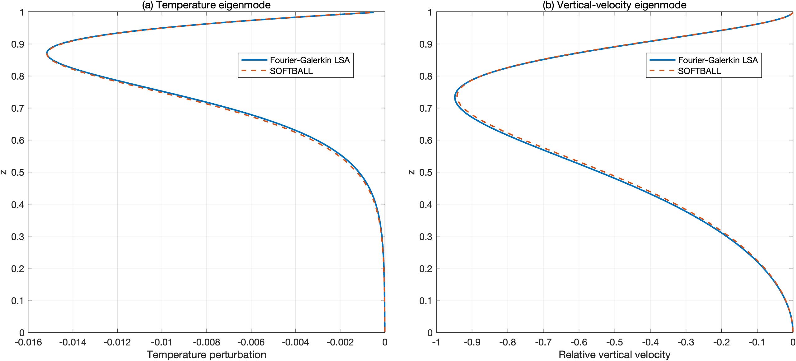

# SOFTBALL — Moving-Frame Momentum Correction

**Correction of the moving-frame Darcy–Brinkman momentum formulation in SOFTBALL, with independent numerical verification.**

This repository is a modified fork of [SOFTBALL](https://github.com/jrgparkinson/mushy-layer), a Chombo-based adaptive mesh refinement framework for modelling binary-alloy solidification, mushy-layer convection, and coupled heat and solute transport.

The modifications address an inconsistency in the original moving-frame momentum formulation, extend the corresponding C++ implementation, and introduce an independent benchmark based on forced-throughflow Rayleigh–Bénard convection.

## 1. Identified issue

In SOFTBALL, the Darcy velocity is defined relative to the solid matrix. When the solid matrix translates, the momentum equation must consistently account for the resulting reference-frame transport.

The original formulation includes the moving-frame advection contribution in the scalar transport equations, but omits the corresponding contribution from the Darcy–Brinkman momentum equation.

This inconsistency becomes particularly important when the momentum advection terms are retained, as the transport velocity and the velocity variable being advected must be distinguished.

The required correction includes the additional moving-frame advection contribution and, for spatially varying porosity, the corresponding terms arising from the distinction between Darcy and interstitial velocities.

## 2. Implemented corrections

The following modifications have been introduced into the SOFTBALL C++ code:

- **Moving-frame momentum advection:** Added the transport contribution associated with solid-matrix translation to the momentum formulation.
- **Velocity prediction:** Modified the Godunov-based velocity predictor to account for the frame velocity when constructing advective fluxes.
- **Porosity-dependent formulation:** Incorporated the additional terms arising from spatial variations in porosity and the relationship between Darcy velocity and interstitial velocity.
- **Momentum discretisation:** Updated the relevant conservative and non-conservative advection paths.
- **Benchmark implementation:** Added initialisation routines for independent stability tests, together with additional numerical diagnostics.

The main modifications are located in:

- `srcSubcycle/AMRLevelMushyLayerVel.cpp`
- `srcSubcycle/AMRLevelMushyLayerInit.cpp`
- `srcSubcycle/AMRLevelMushyLayer.cpp`

The changes preserve the underlying SOFTBALL numerical framework while correcting its treatment of moving-frame momentum transport.

## 3. Independent numerical verification

The corrected momentum solver was tested against an independent Fourier–Galerkin linear stability analysis (LSA) of Rayleigh–Bénard convection with imposed vertical throughflow.

This benchmark was specifically constructed to reproduce the mathematical structure of solid-matrix translation in SOFTBALL when expressed in terms of relative velocity.

In the single-phase limit, the forced-throughflow problem and the moving-frame formulation become mathematically equivalent under consistent velocity and boundary-condition definitions.

Unlike a simple reference-frame transformation test, the imposed throughflow produces a non-uniform background temperature profile and modifies the linear instability problem.

### Eigenmode comparison

The dominant temperature and vertical-velocity perturbation profiles obtained from SOFTBALL show close agreement with the independent Fourier–Galerkin predictions.

A single amplitude scaling factor is determined from the temperature perturbation and applied to both theoretical profiles, allowing the relative amplitudes of the temperature and velocity perturbations to be compared without separate fitting.

### Temporal growth rates

The growth rates obtained from the benchmark are:

| Method | Growth rate |
|---|---:|
| Independent Fourier–Galerkin LSA | 0.906910 |
| SOFTBALL — temperature perturbation | 1.079805 |
| SOFTBALL — vertical-velocity perturbation | 1.078003 |

The numerical growth rates differ from the theoretical prediction by approximately 0.17 in absolute terms. Both approaches predict the same unstable mode, with close agreement in its spatial structure.

The benchmark directly tests moving-frame momentum transport in the single-phase limit. Additional terms associated with spatially varying porosity are included in the corrected implementation but are not independently benchmarked here.

**For the benchmark formulation, numerical configuration, MATLAB analysis and detailed results, see [Validation and Benchmark](validation/README.md).**

## 4. Verification materials

The [`validation/`](validation/) directory contains:

- [`README.md`](validation/README.md) — Benchmark formulation, numerical methodology and results.
- [`Translating_RB.m`](validation/Translating_RB.m) — Independent Fourier–Galerkin linear stability analysis and SOFTBALL post-processing.
- [`inputs`](validation/inputs) — SOFTBALL configuration for the benchmark.
- [`eigenmode_comparison.png`](validation/eigenmode_comparison.png) — Comparison of temperature and vertical-velocity eigenmodes.
- [`growth_rate.png`](validation/growth_rate.png) — Temporal growth-rate diagnostics.

The benchmark uses the original SOFTBALL finite-volume framework and an independently constructed spectral stability calculation.

## 5. Original software and attribution

The underlying SOFTBALL framework was developed by Parkinson and collaborators using the Chombo adaptive mesh refinement library.

This fork builds upon the original implementation. The moving-frame momentum corrections, additional benchmark configurations, and independent stability analysis are subsequent contributions.

**Original publication:**

Parkinson, J. R. G., Martin, D. F., Wells, A. J. & Katz, R. F. (2020). *Modelling binary alloy solidification with adaptive mesh refinement*. Journal of Computational Physics: X, 5, 100043.

**Original repository:**

https://github.com/jrgparkinson/mushy-layer

For the original numerical framework, dependencies, compilation instructions and existing test cases, please refer to the upstream documentation.

## 6. Documentation

- [Moving-frame momentum benchmark and verification](validation/README.md)
- [Original SOFTBALL repository](https://github.com/jrgparkinson/mushy-layer)
