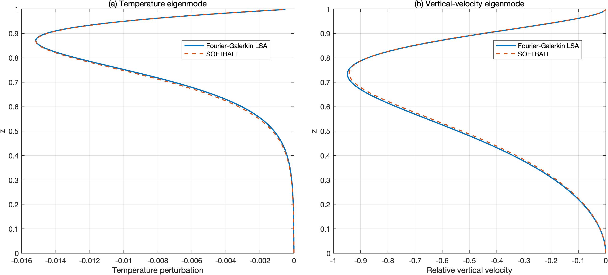
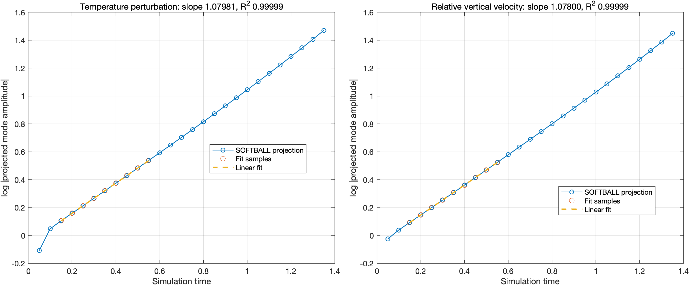

# Verification of the Moving-Frame Momentum Solver

## 1. Overview

This benchmark evaluates the corrected moving-frame momentum formulation in [SOFTBALL](https://github.com/jrgparkinson/mushy-layer) against an independent linear stability analysis (LSA) of Rayleigh–Bénard convection with imposed vertical throughflow.

The benchmark is designed to test the additional momentum advection associated with translation of the solid matrix. In the single-phase limit, the SOFTBALL formulation can be reduced to a mathematically equivalent forced-throughflow problem when both are expressed in terms of relative velocity.

The primary verification is based on comparing the spatial structure of the dominant instability mode obtained from an independent Fourier–Galerkin calculation and the SOFTBALL finite-volume simulation. Temporal growth rates are also compared as a supplementary diagnostic.

## 2. Benchmark formulation

Consider a fluid layer occupying \(0 \leq z \leq 1\), with a uniform imposed vertical throughflow \(V\) and fixed temperatures \(\theta_d\) and \(\theta_u\) at the lower and upper boundaries.

The fluid velocity at both boundaries is prescribed as \(V\mathbf e_z\). Defining the relative velocity by

\[
\mathbf u=\mathbf v-V\mathbf e_z
\]

gives homogeneous Dirichlet conditions for \(\mathbf u\).

The momentum equation for the relative velocity contains the background advection contribution

\[
V\frac{\partial\mathbf u}{\partial z},
\]

in addition to the usual nonlinear advection.

In SOFTBALL, the Darcy velocity is defined relative to the solid matrix. When the porosity is set to unity, the translating-solid formulation reduces to the same relative-velocity equations under consistent reference-frame and sign conventions.

This correspondence allows the moving-frame momentum implementation to be tested without introducing additional effects from phase change or spatially varying porosity.

### Background temperature

The steady background temperature satisfies

\[
\frac{d^2\theta_0}{dz^2}
-
V\frac{d\theta_0}{dz}=0,
\]

with \(\theta_0(0)=\theta_d\) and \(\theta_0(1)=\theta_u\).

The resulting profile is

\[
\theta_0(z)=
\frac{e^V\theta_d-\theta_u-(\theta_d-\theta_u)e^{Vz}}{e^V-1}.
\]

Unlike classical Rayleigh–Bénard convection, the background temperature is nonlinear in height because of the imposed throughflow.

## 3. Independent linear stability analysis

The perturbation equations are solved using a Fourier–Galerkin expansion.

The temperature perturbation is expanded in sine functions, while the vertical-velocity basis is constructed to satisfy the homogeneous velocity boundary conditions.

The resulting discretised equations take the form

\[
L\frac{d\mathbf q}{dt}=R\mathbf q.
\]

The dominant eigenvalue determines the theoretical linear growth rate, while its associated eigenvector provides the predicted temperature and vertical-velocity perturbation profiles.

The MATLAB implementation is independent of SOFTBALL's finite-volume discretisation.

## 4. Numerical configuration

| Parameter | Value |
|---|---|
| Rayleigh number, \(Ra\) | 21000 |
| Prandtl number, \(Pr\) | 1 |
| Imposed throughflow, \(V\) | 10 |
| Lower temperature, \(\theta_d\) | 2.1 |
| Upper temperature, \(\theta_u\) | 1.1 |
| Horizontal wavenumber | 4.86 |
| Galerkin truncation | 512 modes |
| SOFTBALL resolution | 664 × 256 |
| Adaptive mesh refinement | Disabled |

The SOFTBALL configuration is provided in [`inputs`](inputs), and the independent stability calculation and post-processing are implemented in [`Translating_RB.m`](Translating_RB.m).

## 5. Verification results

### 5.1 Eigenmode profiles

The dominant temperature and vertical-velocity perturbation profiles predicted by the Fourier–Galerkin LSA are compared with those extracted from the SOFTBALL simulation.

A single amplitude scaling factor is determined from the temperature perturbation and subsequently applied to both theoretical profiles. The velocity eigenmode is not independently rescaled.

The resulting profiles show close agreement throughout the fluid layer, including the locations of extrema and the asymmetric vertical structures induced by the throughflow.

The agreement between the independently calculated eigenmode profiles and the SOFTBALL results provides evidence that the corrected solver captures the expected instability mode under non-zero background advection.

### 5.2 Temporal growth rates

The temporal growth rates are extracted from the temperature and vertical-velocity fields by projecting each perturbation onto the corresponding LSA eigenmode and fitting the logarithm of its amplitude over the linear-growth interval.

The results are:

| Quantity | Growth rate |
|---|---:|
| Fourier–Galerkin LSA | 0.9069 |
| SOFTBALL — temperature | 1.0798 |
| SOFTBALL — vertical velocity | 1.0780 |

The SOFTBALL growth rates differ from the LSA prediction by approximately 0.17 in absolute terms, corresponding to a relative difference of about 19%. Both approaches predict an unstable mode with a positive growth rate of order unity.

The comparison is performed at a single spatial resolution, and a systematic convergence study of the growth-rate discrepancy has not been carried out.

## 6. Interpretation and scope

The close agreement between the eigenmode profiles obtained from the independent Fourier–Galerkin analysis and the SOFTBALL simulation provides evidence for the corrected moving-frame momentum formulation in the tested configuration.

The benchmark is particularly relevant to the momentum correction because the imposed throughflow produces a non-trivial background temperature distribution and introduces additional momentum advection.

The present test is restricted to the single-phase limit, \(\chi=1\). Consequently, the additional terms involving spatial gradients of porosity are not independently tested here.

The results provide targeted verification of the moving-frame momentum formulation, rather than comprehensive verification of all numerical schemes and physical processes implemented in SOFTBALL.

## 7. Files and reproduction

The following files are provided:

- [`Translating_RB.m`](Translating_RB.m): Independent Fourier–Galerkin LSA, SOFTBALL HDF5 post-processing, eigenmode comparison and temporal growth-rate fitting.
- [`inputs`](inputs): SOFTBALL configuration used for the benchmark.
- [`eigenmode_comparison.png`](eigenmode_comparison.png): Comparison of temperature and vertical-velocity perturbation profiles.
- [`growth_rate.png`](growth_rate.png): Temporal growth-rate fits for both perturbation fields.

To reproduce the comparison, run SOFTBALL using the supplied configuration and place the resulting HDF5 plot files in the directory expected by the MATLAB script.

Run `Translating_RB.m` to calculate the independent eigenmodes, extract the numerical perturbations and generate the comparison figures.

The HDF5 reader is configured for the supplied single-level SOFTBALL output and is not intended as a general-purpose Chombo plot-file reader.
